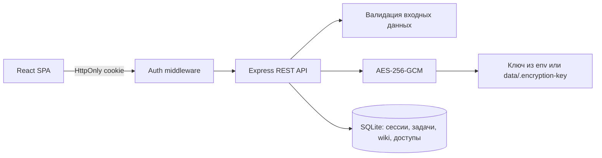

# Архитектура

## Обзор

Приложение разделено на браузерный React-клиент и HTTP-сервер Express. Сервер — единственный владелец SQLite-базы, сессий и ключа шифрования. В development Vite отдаёт клиент и проксирует `/api`; в production Express отдаёт и статику, и API.



Такой вариант подходит для локального однопользовательского приложения: не требует отдельной СУБД, имеет один production-процесс и не добавляет ORM без необходимости.

## Структура

```text
src/
  app/                     # Точка входа, AuthProvider, защита маршрутов, layout
    providers/
  pages/
    login/                 # Страница входа без регистрации
    tasks/                 # Страница задач: UI, состояние и её API
      api/
      model/
      ui/
    wiki/                  # Текстовая база знаний
      api/
      model/
      ui/
    passwords/             # Независимое хранилище доступов
      api/
      model/
      ui/
  shared/
    api/                   # Fetch-клиент, обработка 401 и транспортная ошибка
    auth/                  # AuthContext, DTO и запросы сессии
    ui/                    # Button, Icon, Modal, ConfirmDialog
server/
  index.js                 # Жизненный цикл HTTP-сервера
  app.js                   # Middleware, маршруты, раздача dist
  auth-routes.js           # Login, session, logout
  auth-service.js          # Cookie, сессии, scrypt и rate limit
  database.js              # Подключение, схема и миграции SQLite
  task-routes.js           # REST задач
  wiki-routes.js           # REST документов wiki
  password-routes.js       # REST доступов и reveal пароля
  secrets.js               # Шифрование секретов
  validation.js            # Граница доверия для входных данных
  config.js                # Конфигурация окружения
data/                      # Runtime-данные, не входит в Git
docs/
```

Клиент следует Feature-Sliced Design v2.1. Используются только необходимые слои `app → pages → shared`. Логика и запросы остаются у страницы-владельца; `entities`, `features` и `widgets` появятся только при реальном повторном использовании. Внешние импорты страниц и компонентов идут через их `index.ts`.

Wiki и хранилище паролей не импортируют друг друга и имеют отдельные DTO, состояние, таблицы и REST-маршруты.

Wiki состоит из списка `/wiki` и страницы документа `/wiki/:id`. В `wiki_entries.content` хранится исходный Markdown. Компонент `MarkdownView` отображает его через `react-markdown` и `remark-gfm` в списке, предпросмотре редактора и на странице чтения. Встроенный HTML не активируется и `dangerouslySetInnerHTML` не используется.

## Авторизация

Приложение имеет один аккаунт из `AUTH_USERNAME` и `AUTH_PASSWORD`, без регистрации и таблицы пользователей. Для локального запуска предусмотрены credentials из README; перед сетевым развёртыванием их необходимо заменить.

1. `POST /api/auth/login` проверяет логин через сравнение хешей и пароль через `scrypt` с `timingSafeEqual`.
2. Сервер создаёт случайный 256-битный токен. В cookie попадает исходный токен, в `sessions` — только SHA-256-хеш.
3. Cookie `tochka_session` имеет `HttpOnly`, `SameSite=Strict`, `Path=/` и срок 7 дней. `Secure` включается через `COOKIE_SECURE=true` при HTTPS.
4. `requireAuth` проверяет сессию для всех прикладных `/api`-маршрутов. Публичны только health и auth endpoints.
5. `GET /api/auth/session` восстанавливает состояние при загрузке SPA. Ответ 401 инициирует очистку клиентской сессии и переход на `/login`.
6. `POST /api/auth/logout` удаляет запись сессии и очищает cookie. Клиент очищает состояние даже при ошибке сети.

Неудачные входы ограничены пятью попытками за 15 минут с одного IP. Счётчик находится в памяти процесса и сбрасывается при перезапуске.

## Модель данных

### `sessions`

| Колонка | Тип | Ограничения |
| --- | --- | --- |
| `token_hash` | TEXT | Primary key, SHA-256 токена |
| `username` | TEXT | Имя аккаунта |
| `expires_at` | INTEGER | Unix-время окончания сессии |
| `created_at` | TEXT | UTC ISO-временная метка |

Индекс `expires_at` используется для удаления просроченных сессий при новом входе.

### `tasks`

| Колонка | Тип | Ограничения |
| --- | --- | --- |
| `id` | INTEGER | Primary key |
| `title` | TEXT | Обязательное, до 160 символов |
| `description` | TEXT | До 5000 символов |
| `task_date` | TEXT | Локальная календарная дата `YYYY-MM-DD` |
| `task_time` | TEXT | `HH:MM`, 24 часа |
| `completed` | INTEGER | `0` или `1` |
| `created_at`, `updated_at` | TEXT | UTC ISO-временные метки |

Индекс `(task_date, task_time)` поддерживает основной запрос списка дня. Дата намеренно не хранится как UTC timestamp: день пользователя не должен смещаться из-за часового пояса.

### `wiki_entries`

| Колонка | Тип | Ограничения |
| --- | --- | --- |
| `id` | INTEGER | Primary key |
| `title` | TEXT | Обязательное, до 160 символов |
| `category` | TEXT | По умолчанию `Общее` |
| `content` | TEXT | Markdown, до 20000 символов |
| `created_at`, `updated_at` | TEXT | UTC ISO-временные метки |

Wiki содержит только текстовую информацию. Колонка `encrypted_password` остаётся в старых базах для совместимости миграции, но не используется новым API.

### `password_entries`

| Колонка | Тип | Ограничения |
| --- | --- | --- |
| `id` | INTEGER | Primary key |
| `title` | TEXT | Обязательное, до 160 символов |
| `login` | TEXT | Необязательный, до 320 символов |
| `url` | TEXT | Необязательная HTTP/HTTPS-ссылка |
| `notes` | TEXT | До 5000 символов |
| `encrypted_password` | TEXT | Обязательный envelope `v1:iv:tag:ciphertext` |
| `created_at`, `updated_at` | TEXT | UTC ISO-временные метки |

Пароль не входит в DTO доступа. Отдельный `POST /api/passwords/:id/reveal` расшифровывает значение по явному действию. При редактировании пустое поле пароля означает сохранение старого значения.

При запуске одна транзакция переносит непустые `wiki_entries.encrypted_password` в `password_entries` и очищает старое поле. После успешного переноса повторный запуск не создаёт дубликаты.

## Потоки данных

1. Страница вызывает функцию своего `api`-сегмента.
2. Общий клиент добавляет JSON-заголовки и same-origin cookie, проверяет HTTP-статус и преобразует ответ в типизированный DTO.
3. Express проверяет сессию, валидирует тело и параметры, затем выполняет параметризованный SQL-запрос.
4. CRUD-ответ обновляет локальное состояние страницы без повторной загрузки всего списка.
5. При смене даты задачи загружаются заново; устаревший запрос отменяется через `AbortController`.
6. Расшифрованные пароли существуют только в состоянии страницы хранилища и удаляются из него при скрытии, редактировании или удалении доступа.

## Шифрование и границы безопасности

- Алгоритм AES-256-GCM даёт конфиденциальность и проверку целостности. Для каждого пароля генерируется новый 12-байтовый IV.
- Ключ берётся из `DATA_ENCRYPTION_KEY` (64 hex-символа) либо создаётся локально с правами `0600`.
- SQL-параметры не конкатенируются со значениями пользователя. Динамические имена колонок выбираются только из фиксированного серверного словаря.
- API по умолчанию слушает только `127.0.0.1`; размер JSON ограничен 64 КБ.
- Секреты и credentials не пишутся в логи. React выводит пользовательский текст как текст, без `dangerouslySetInnerHTML`.

Шифрование защищает содержимое базы при утечке файла без ключа, но не заменяет HTTPS. Перед публичным развёртыванием нужны собственные credentials, HTTPS, мониторинг и политика резервного копирования.

## Эксплуатация и развитие

SQLite работает в WAL-режиме. Резервную копию следует делать согласованно с базой и хранить ключ отдельно от неё. При появлении нескольких пользователей следующими изменениями будут: таблица пользователей, `user_id` во всех записях, нормализация прав доступа и миграции схемы с версиями. Для высокой нагрузки или нескольких серверных инстансов SQLite и in-memory rate limit следует заменить на общие серверные хранилища, сохранив REST-контракт клиента.
