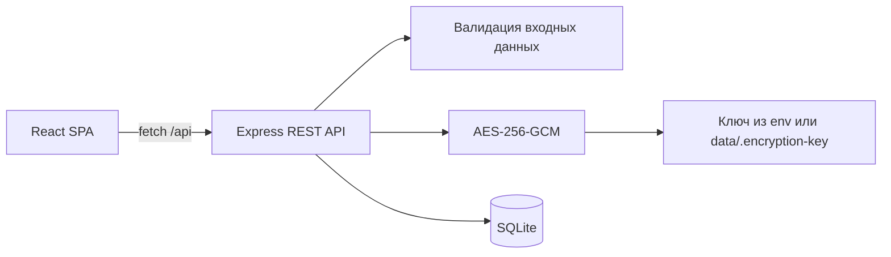

# Архитектура

## Обзор

Приложение разделено на браузерный React-клиент и HTTP-сервер Express. Сервер — единственный владелец SQLite-базы и ключа шифрования. В development Vite отдаёт клиент и проксирует `/api`; в production Express отдаёт и статику, и API.



Такой вариант подходит для локального однопользовательского приложения: не требует отдельной СУБД, имеет один production-процесс и не добавляет ORM без необходимости.

## Структура

```text
src/
  app/                     # Точка входа, роутинг, layout, глобальные стили
  pages/
    tasks/                 # Страница задач: UI, состояние и её API
      api/
      model/
      ui/
    wiki/                  # Страница базы знаний
      api/
      model/
      ui/
  shared/
    api/                   # Fetch-клиент и транспортная ошибка
    ui/                    # Button, Icon, Modal, ConfirmDialog
server/
  index.js                 # Жизненный цикл HTTP-сервера
  app.js                   # Middleware, маршруты, раздача dist
  database.js              # Подключение и схема SQLite
  task-routes.js           # REST задач
  wiki-routes.js           # REST wiki и reveal пароля
  secrets.js               # Шифрование секретов
  validation.js            # Граница доверия для входных данных
  config.js                # Конфигурация окружения
data/                      # Runtime-данные, не входит в Git
docs/
```

Клиент следует Feature-Sliced Design v2.1. Используются только необходимые слои `app → pages → shared`. Логика и запросы остаются у страницы-владельца; `entities`, `features` и `widgets` появятся только при реальном повторном использовании. Внешние импорты страниц и компонентов идут через их `index.ts`.

## Модель данных

### `tasks`

| Колонка | Тип | Ограничения |
| --- | --- | --- |
| `id` | INTEGER | Primary key |
| `title` | TEXT | Обязательное, до 160 символов |
| `description` | TEXT | До 5000 символов |
| `task_date` | TEXT | Локальная календарная дата `YYYY-MM-DD` |
| `task_time` | TEXT | `HH:MM`, 24 часа |
| `completed` | INTEGER | `0` или `1` |
| `created_at`, `updated_at` | TEXT | UTC ISO-временные метки |

Индекс `(task_date, task_time)` поддерживает основной запрос списка дня. Дата намеренно не хранится как UTC timestamp: день пользователя не должен смещаться из-за часового пояса.

### `wiki_entries`

| Колонка | Тип | Ограничения |
| --- | --- | --- |
| `id` | INTEGER | Primary key |
| `title` | TEXT | Обязательное, до 160 символов |
| `category` | TEXT | По умолчанию `Общее` |
| `content` | TEXT | До 20000 символов |
| `encrypted_password` | TEXT | NULL или envelope `v1:iv:tag:ciphertext` |
| `created_at`, `updated_at` | TEXT | UTC ISO-временные метки |

Пароль не входит в DTO записи. Клиент получает только `hasPassword`; отдельный `POST /api/wiki/:id/reveal` расшифровывает значение по явному действию. При редактировании пустое поле пароля сохраняет старое значение, а `clearPassword: true` удаляет его.

## Потоки данных

1. Страница вызывает функцию своего `api`-сегмента.
2. Общий клиент добавляет JSON-заголовки, проверяет HTTP-статус и преобразует ответ в типизированный DTO.
3. Express валидирует тело и параметры, затем выполняет параметризованный SQL-запрос.
4. CRUD-ответ обновляет локальное состояние страницы без повторной загрузки всего списка.
5. При смене даты задачи загружаются заново; устаревший запрос отменяется через `AbortController`.

## Шифрование и границы безопасности

- Алгоритм AES-256-GCM даёт конфиденциальность и проверку целостности. Для каждого пароля генерируется новый 12-байтовый IV.
- Ключ берётся из `DATA_ENCRYPTION_KEY` (64 hex-символа) либо создаётся локально с правами `0600`.
- SQL-параметры не конкатенируются со значениями пользователя. Динамические имена колонок выбираются только из фиксированного серверного словаря.
- API по умолчанию слушает только `127.0.0.1`; размер JSON ограничен 64 КБ.
- Секреты не пишутся в логи. React выводит пользовательский текст как текст, без `dangerouslySetInnerHTML`.

В текущей версии нет аутентификации. Шифрование защищает содержимое базы при утечке файла без ключа, но не заменяет контроль доступа к работающему API. Перед сетевым развёртыванием нужны вход пользователя, HTTPS, авторизация каждого запроса и политика резервного копирования.

## Эксплуатация и развитие

SQLite работает в WAL-режиме. Резервную копию следует делать согласованно с базой и хранить ключ отдельно от неё. При появлении нескольких пользователей следующими изменениями будут: таблица пользователей и сессий, `user_id` во всех записях, авторизация в middleware и миграции схемы с версиями. Для высокой нагрузки или нескольких серверных инстансов SQLite следует заменить на клиент-серверную СУБД, сохранив REST-контракт клиента.
